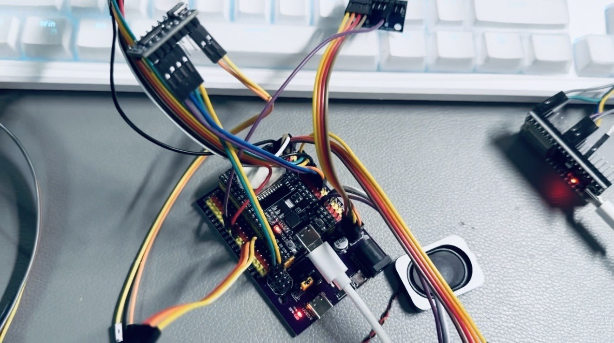

# LoRa 仓库物品追踪定位系统

[](https://github.com/rongyishuaige7/lora-warehouse-tracking-system/actions/workflows/validate.yml)
[](LICENSE)

一个面向教学、毕业设计参考和原型验证的软硬件闭环：ESP32 标签采集状态并通过 433 MHz LoRa 上报，ESP32 网关把接收数据转发给 Flask/SQLite 服务，Kotlin Android App 展示最近区域并可尝试下发语音查找指令。

> **项目状态（2026-07-17）：** 标签和网关固件已通过 PlatformIO 构建；Flask 服务端 11 项测试通过；Android 单元测试与 Debug APK 构建通过。**当前提交尚未做端到端真机复测**，仓库也未提供实物照片、演示视频、App 截图、EDA、PCB 或制造文件。详见 [项目状态](docs/PROJECT_STATUS.md) 与 [验证记录](docs/VERIFICATION.md)。

> **安全边界：** API、网关控制端点与 LoRa 消息均无认证或加密。本项目只适合隔离的可信局域网和教学环境，禁止直接暴露公网，也不能作为真实资产安全系统、工业级定位系统或生产服务使用。

## Historical material evidence (2026-07-18 publication)

sanitized historical photo(s), historical EDA derivative(s). See [MEDIA_EVIDENCE](docs/MEDIA_EVIDENCE.md) for dates, sanitization, omissions, and evidence limits.



Historical media/EDA do not prove that the current public commit was flashed or re-tested on hardware. **Current hardware re-test not run.**


## 系统闭环

```text
DHT11 / MPU6050 / 霍尔 ─→ ESP32 标签 ── LoRa 433 MHz ──→ ESP32 网关
                               ↑                              │
                         JQ6500 / OLED                        │ Wi-Fi HTTP
                               │                              ↓
                         清醒窗口接收指令              Flask + SQLite
                                                              │
                                                              ↓
                                                       Kotlin Android App
```

这是结构示意，不是 PCB 原理图，也不代表任何设备当前在线。

## 能力与真实边界

| 模块 | 当前实现 | 必须同时知道的边界 |
|---|---|---|
| 标签 | DHT11、MPU6050、霍尔状态、OLED、JQ6500、深睡与 LoRa | 电池 ADC 未实现，协议返回 `null`；DHT 失败也返回 `null` |
| 区域定位 | 以**接收到上报的网关区域**作为最近区域；短时间多网关接收时保留更强 RSSI | 这是区域级原型，不是测距、GPS 或精确坐标定位 |
| 查找 | 服务端向最近区域网关下发 `PLAY_VOICE` | 只确认“已下发到网关”，不确认标签收到或实际播放 |
| 深睡 | 定时、MPU6050 GPIO33、霍尔 GPIO13 唤醒 | LoRa DIO0 不是深睡唤醒源；`QUERY` 只能请求**清醒中的标签**立即上报 |
| 服务端 | Flask REST API、SQLite 设备/历史记录、区域统计 | 无认证、无 TLS；浏览器 CORS 默认关闭 |
| Android | 列表、搜索、A/B 区域筛选、服务器设置、查找请求 | 默认 `10.0.2.2` 仅用于模拟器；明文 HTTP 只允许回环、模拟器或 RFC1918 私网 |

## 仓库结构

| 路径 | 内容 |
|---|---|
| [`esp32_tag/`](esp32_tag/) | Arduino IDE 标签源码与本地配置模板 |
| [`esp32_gateway/`](esp32_gateway/) | Arduino IDE 网关源码与本地配置模板 |
| [`firmware/`](firmware/) | PlatformIO 轻量适配入口；复用上述 `.ino` 主体 |
| [`platformio.ini`](platformio.ini) | 固定平台、板型、库版本与两个构建环境 |
| [`server/`](server/) | Flask/SQLite 后端与 pytest |
| [`android_app/`](android_app/) | Kotlin Android App，`minSdk 23` |
| [`hardware/BOM.csv`](hardware/BOM.csv) | 从源码推导、标明待实物确认的 BOM |
| [`hardware/wiring-diagram.svg`](hardware/wiring-diagram.svg) | 接线边界图，不是 PCB 原理图 |
| [`HARDWARE.md`](HARDWARE.md) | 引脚、电源与无线边界 |
| [`docs/PROTOCOL.md`](docs/PROTOCOL.md) | LoRa、网关 HTTP 与 Flask API 语义 |

## 快速开始

### 1. 构建标签与网关固件

安装 [PlatformIO Core](https://docs.platformio.org/) 后：

```bash
cp esp32_tag/config.example.h esp32_tag/config.h
cp esp32_gateway/config.example.h esp32_gateway/config.h
pio run -e tag
pio run -e gateway
```

烧录前根据自己的可信局域网修改两个 `config.h`。它们被 `.gitignore` 和仓库检查脚本阻断，不得提交真实 SSID、密码或设备私网配置。

本项目按现有源码固定：

- PlatformIO `espressif32@6.13.0`；
- `board = esp32dev`；
- Arduino framework；
- LoRa 频率 `433 MHz`，Sync Word `0x12`。

如果你的实物不是通用 ESP32 Dev Module、不是 433 MHz 模块，或引脚不同，必须先核对 [HARDWARE.md](HARDWARE.md)。

### 2. 启动 Flask 服务

```bash
cd server
python3 -m venv .venv
. .venv/bin/activate
pip install -r requirements.txt -r requirements-dev.txt
cp config.example.json config.json
python server.py
```

把 `config.json` 中的 A/B 地址改成真实网关的可信局域网 URL。默认代码不内置历史局域网地址。服务端数据库默认位于 `server/warehouse.db`，已被忽略。

若确实有受信任的浏览器前端，可显式声明允许的 Origin：

```bash
WAREHOUSE_CORS_ORIGINS=http://127.0.0.1:8000 python server.py
```

不设置时浏览器 CORS 默认关闭；Android 原生客户端不依赖 CORS。

### 3. 构建 Android App

需要 JDK 17 与 Android SDK 34：

```bash
cd android_app
ANDROID_HOME="$HOME/Android/Sdk" ./gradlew --no-daemon testDebugUnitTest assembleDebug
```

Debug APK 位于 `android_app/app/build/outputs/apk/debug/app-debug.apk`。它是开发构建，不是签名发布包。App 默认连接模拟器宿主机 `http://10.0.2.2:5000/`；真机请在 App 的“服务器”设置里填写服务电脑的可信局域网地址。

### 4. 一键本地验证

```bash
bash scripts/verify.sh
```

该脚本运行 Secret scan、仓库结构检查、两端固件构建、Flask 测试、Python 语法检查和 Android 单元测试/Debug 构建。它不会烧录硬件，也不会把本机 SDK 路径写进仓库。

## 核心语义

### 区域是谁决定的

标签报文中的 `region` 只是本地提示。服务端正常情况下以**接收网关上报的 `region`**为权威；只有网关区域缺失或为 `UNKNOWN` 时，才回退到标签提示。若同一标签在 3 秒内被多个网关接收，服务端保留 RSSI 更强的记录。

### `QUERY` 不能唤醒深睡标签

当前标签只通过以下来源从深睡唤醒：

- 30 秒定时器；
- MPU6050 中断 GPIO33；
- 霍尔传感器 GPIO13。

LoRa DIO0 没有配置为深睡唤醒源。`QUERY:TAG001` 仅在标签已经处于约 10 秒清醒窗口时请求立即上报；服务端的查找接口不会阻塞等待或假设 `QUERY` 能唤醒标签。

### 查找返回值不等于播放成功

`POST /api/locate` 的 `gateway_command_sent=true` 只证明 Flask 收到网关 HTTP 200。当前协议没有标签 ACK，因此：

- 不确认 LoRa 指令抵达；
- 不确认 JQ6500 中存在音频；
- 不确认标签实际播放；
- 若标签深睡，应在下一次心跳后的清醒窗口重试。

## 主要接口

| 方法 | 路径 | 作用 |
|---|---|---|
| `POST` | `/api/report` | 网关上报一条或多条标签数据 |
| `GET` | `/api/devices` | 获取设备列表 |
| `GET` | `/api/devices/<id>` | 获取单个设备 |
| `GET` | `/api/search?q=` | 搜索设备 |
| `GET` | `/api/regions` | 区域计数；当前 App 固定展示 A/B |
| `POST` | `/api/locate` | 返回最近区域并尝试向网关下发语音 |
| `GET` | `/api/history/<id>?limit=50` | 最近历史记录，最大 500 条 |
| `GET` | `/api/health` | 进程/配置自检，不代表网关或标签在线 |

完整字段与示例见 [docs/PROTOCOL.md](docs/PROTOCOL.md)。

## 已知限制

- 当前提交未进行标签烧录、网关烧录、LoRa 通信、Wi-Fi/HTTP、App 真机和 JQ6500 端到端复测；
- 仓库没有当前实物照片、演示视频、App 截图或 EDA/制造文件；
- 电池值不可用，DHT 读取失败与未实现测量都用 `null/N/A`，不会伪装成 0 或 3.7 V；
- App 的区域概览与筛选目前固定为 A/B，后端可记录其他区域但 App 不会自动生成卡片；
- LoRa、Flask API 和网关 `/control` 均无认证、加密或重放保护；
- 网关使用明文 HTTP，服务端下发只证明网关接收，不证明标签执行；
- 433 MHz 的合法频率、功率、天线和使用条件必须按所在地法规及模块规格确认；
- `esp32dev` 是当前可构建目标，不证明与未知实物板型完全一致；
- Android/Gradle、Python 和 PlatformIO 会下载第三方依赖，细节见 [THIRD_PARTY_NOTICES.md](THIRD_PARTY_NOTICES.md)。

## 安全、许可证与教学使用

- 安全与网络边界：[SECURITY.md](SECURITY.md)
- 本项目自有源码：MIT，见 [LICENSE](LICENSE)
- 第三方组件：[THIRD_PARTY_NOTICES.md](THIRD_PARTY_NOTICES.md)
- 来源裁决：[docs/SOURCE_PROVENANCE.md](docs/SOURCE_PROVENANCE.md)
- 真机复测清单：[docs/VERIFICATION.md](docs/VERIFICATION.md)

欢迎用于课程实验、毕业设计参考和个人学习。请保留许可证与来源，并明确标注自己修改、实现和验证的部分；不要把本教学原型描述成生产可用、安全追踪或工业级系统。
